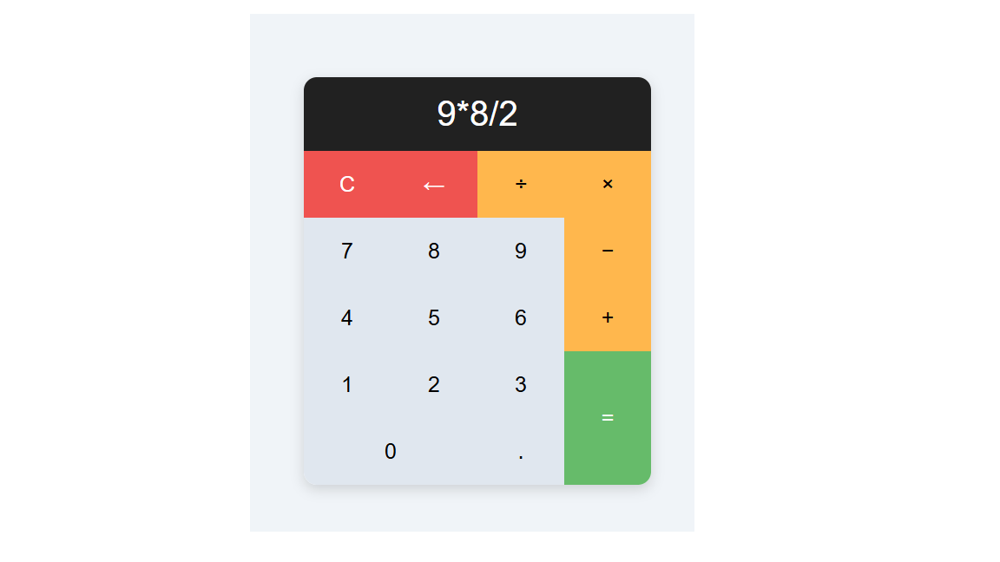
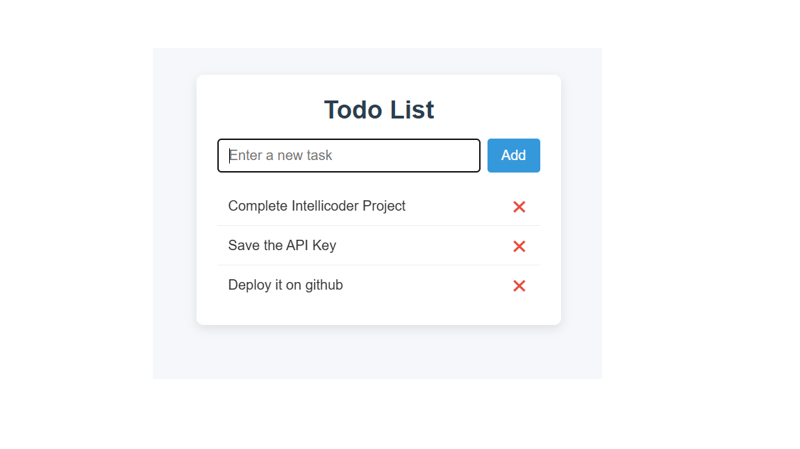

# IntelliCoder

An AI software engineer built with LangGraph. Give it a one-line prompt
and it plans, designs and writes a working web app.

## How it works

User prompt → **Planner** → **Architect** → **Coder** (loops once per file) → done

- **Planner**: turns the prompt into a structured plan (features, tech stack, files)
- **Architect**: turns the plan into step-by-step implementation tasks per file
- **Coder**: writes each file, seeing the files already written so names match

Built with LangChain, LangGraph, Pydantic structured outputs and Groq (gpt-oss).

## Examples generated by the agent

| App | Prompt | Folder |
|-----|--------|--------|
| Calculator | "Build a simple calculator in html css and js" | `examples/calculator` |
| To-do app | "Build a simple todo app in html css and js" | `examples/todo-app` |

Open `examples/<app>/index.html` in a browser to try them.

### Screenshots

**Calculator**

**To-do app**

## Run it yourself

1. Install [uv](https://docs.astral.sh/uv/) and run `uv sync`
2. Create a `.env` file with `GROQ_API_KEY=your_key`
3. Run `uv run main.py`, enter a folder name and a prompt
4. Find the output in `generated_project/<folder name>`

## Improvements over the tutorial

- Output goes to a separate folder per project, so runs never overwrite each other
- The coder reads earlier files so HTML, CSS and JS stay consistent
- Files are saved by Python code instead of LLM tool calls, which fixed frequent JSON parsing failures
- Retries and pauses handle Groq's free-tier rate limits

## Credits

Based on a tutorial project by codebasics, extended with the improvements above.